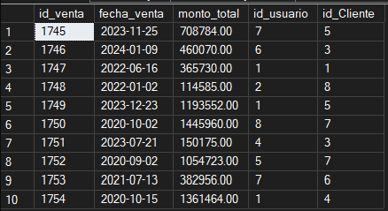
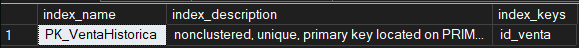
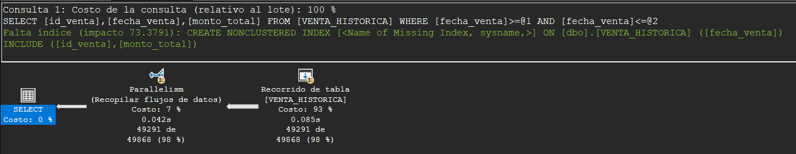
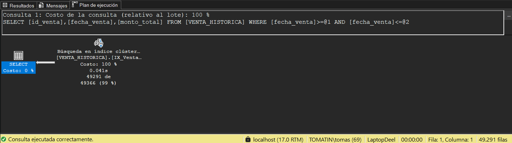
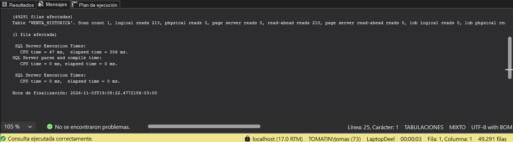
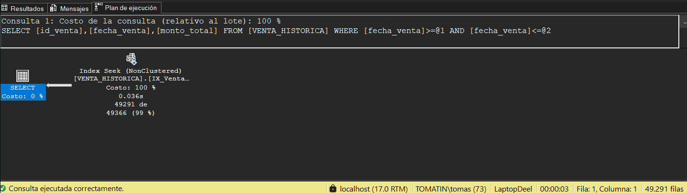

# Etapa V — Tema Técnico: Optimización de Consultas mediante Índices

> **Tema:** Indexación y optimización de consultas

## 1. Definición y objetivo

Un **índice** es una estructura que SQL Server mantiene aparte de la tabla para localizar información de forma más eficiente. Funciona como el índice de un libro: en lugar de recorrer todas las páginas para encontrar un tema, permite ir directamente a la página buscada.

Sin índice, ante una consulta con filtro, el motor debe leer **todas las filas** de la tabla (*Table Scan*). Con un índice adecuado, puede leer únicamente las filas que cumplen el filtro (*Index Seek*).

El objetivo de esta etapa es **medir el impacto de los índices** sobre una consulta por período, en una tabla con un millón de registros, comparando tres escenarios: sin índice, con un índice agrupado sobre la fecha y con un índice no agrupado de cobertura.

## 2. Ventajas y aplicaciones

- **Menos lecturas de datos:** el motor analiza solo la porción de la tabla que necesita.
- **Consultas más rápidas** en tablas con grandes volúmenes, sobre todo con filtros por fecha, cliente, producto o código.
- **Escalabilidad:** el sistema sigue respondiendo bien aunque la tabla crezca.

**Costos a tener en cuenta:** los índices ocupan espacio en disco y hacen algo más lentas las operaciones `INSERT`, `UPDATE` y `DELETE`, porque el motor debe mantenerlos actualizados. Por eso no conviene indexar todas las columnas, sino las que se usan con frecuencia en filtros.

**Tipos de índice utilizados:**

| | Agrupado (clustered) | No agrupado (nonclustered) |
|---|---|---|
| Qué hace | Ordena físicamente la tabla según la columna indexada | Crea una estructura aparte que apunta a las filas |
| Cantidad por tabla | Solo uno | Varios |
| Con `INCLUDE` | No aplica | Puede incluir columnas adicionales para "cubrir" la consulta |

Un índice **de cobertura** es un índice no agrupado que incluye todas las columnas que pide la consulta, de modo que SQL Server puede resolverla usando solamente el índice, sin acceder a la tabla.

## 3. Implementación en SQL Server

**Tabla de prueba.** Se creó `VENTA_HISTORICA`, con estructura similar a `VENTA` (`id_venta`, `fecha_venta`, `monto_total`, `id_usuario`, `id_Cliente`). Se usó una tabla aparte porque `VENTA` ya tiene un índice agrupado sobre su clave primaria (`id_venta`) y una tabla solo admite uno. En `VENTA_HISTORICA` la clave primaria se declaró `NONCLUSTERED`, de modo que la tabla arranca sin índice agrupado ni índice sobre la fecha.

**Carga masiva.** Con un script automático se insertaron **1.000.000 de registros**, con fechas al azar entre 2020 y 2024, montos y usuarios/clientes aleatorios.

```sql
-- 1. ¿Cuántas filas hay?
SELECT COUNT(*) AS CantidadRegistros
FROM VENTA_HISTORICA;
```


```sql
-- 2. Un vistazo a los datos
SELECT TOP 10 *
FROM VENTA_HISTORICA;
```


```sql
-- 3. ¿Qué índices tiene la tabla? 
EXEC sp_helpindex 'VENTA_HISTORICA';
```



**Consulta evaluada.** Ventas del primer trimestre de 2023:

```sql
SELECT id_venta, fecha_venta, monto_total
FROM VENTA_HISTORICA
WHERE fecha_venta BETWEEN '2023-01-01' AND '2023-03-31';
```

Devuelve 49.291 filas (aproximadamente el 5 % de la tabla).

**Cómo se midió.** Antes de cada escenario se activó `SET STATISTICS TIME ON` y `SET STATISTICS IO ON`, se activó el plan de ejecución real (Ctrl+M) y se limpió la memoria con `CHECKPOINT; DBCC DROPCLEANBUFFERS;`, para que los tres escenarios partan en las mismas condiciones.

## 4. Caso concreto aplicado a LaptopDeel

La gerencia de LaptopDeel necesita consultar ventas por período (por ejemplo, el reporte de desempeño por vendedor de la Etapa IV, que filtra por un rango de fechas). A medida que el historial de ventas crece, estas consultas deben analizar cada vez más filas. Un índice sobre la fecha de la venta permite que el tiempo de respuesta dependa de la cantidad de ventas del período consultado y no del tamaño total del historial.

Como la tabla `VENTA` ya tiene su índice agrupado en la clave primaria, en el modelo real el índice por fecha sería de tipo **no agrupado**, como el del Escenario C.

## 5. Script de demostración y resultados obtenidos

### Escenario A — Sin índice

**Plan de ejecución:** `Table Scan` (costo 93 %). SQL Server recorre toda la tabla y usa paralelismo para compensar. SSMS sugiere crear un índice sobre `fecha_venta` que incluya `id_venta` y `monto_total`.




### Escenario B — Índice agrupado sobre la fecha

```sql
CREATE CLUSTERED INDEX IX_VentaHistorica_Fecha
ON VENTA_HISTORICA(fecha_venta);
```

**Plan de ejecución:** `Clustered Index Seek` (costo 100 %). El motor va directo a la zona de la tabla que corresponde al trimestre consultado, sin necesidad de paralelismo.




### Escenario C — Índice no agrupado de cobertura

Se eliminó el índice del Escenario B y se creó el siguiente:

```sql
DROP INDEX IX_VentaHistorica_Fecha
ON VENTA_HISTORICA;

CREATE NONCLUSTERED INDEX IX_VentaHistorica_Fecha_Cobertura
ON VENTA_HISTORICA(fecha_venta)
INCLUDE (id_venta, monto_total);
```

**Plan de ejecución:** `Index Seek (NonClustered)` (costo 100 %), sin `Key Lookup`: el índice contiene todas las columnas que pide la consulta, por lo que no hizo falta acceder a la tabla.






### Comparación

| Escenario | Tiempo CPU (ms) | Tiempo total (ms) | Lecturas lógicas | Operación principal |
|---|---|---|---|---|
| A: sin índice | 155 | 602 | 4588 | Table Scan |
| B: índice agrupado sobre fecha | 62 | 532 | 280 | Clustered Index Seek |
| C: índice con cobertura | 47 | 556 | 213 | Index Seek (NonClustered) |

Los valores de tiempo varían según el hardware; las lecturas lógicas son la medida más estable.

## 6. Conclusiones

- **El índice redujo drásticamente el trabajo del motor.** Las lecturas lógicas bajaron de 4588 (sin índice) a 280 con el índice agrupado, una reducción de aproximadamente el 94 %, y a 213 con el índice de cobertura (aproximadamente el 95 %).
- **El plan de ejecución cambió de escaneo a búsqueda.** Se pasó de `Table Scan` (leer toda la tabla) a `Clustered Index Seek` y luego a `Index Seek` no agrupado, que acceden solo a las filas necesarias.
- **El tiempo de CPU también disminuyó** (155 ms, 62 ms y 47 ms).
- **El tiempo total casi no varió** (602, 532 y 556 ms). Esto se debe a que esa medición incluye la lectura desde disco (la memoria se limpió antes de cada prueba) y la presentación de las 49.291 filas en pantalla, tareas que son iguales con o sin índice. Por eso, para comparar escenarios resultan más confiables las lecturas lógicas y el plan de ejecución.
- **El índice de cobertura mejoró levemente respecto del agrupado** (213 contra 280 lecturas). La diferencia es pequeña porque la tabla tiene pocas columnas; en tablas más anchas, con más columnas que la consulta no necesita, la ventaja del índice de cobertura sería mayor.
- **Los índices tienen un costo:** ocupan espacio y deben actualizarse en cada `INSERT`, `UPDATE` y `DELETE`, por lo que conviene crearlos sobre las columnas que realmente se usan en filtros frecuentes. Además, una tabla admite un solo índice agrupado.
