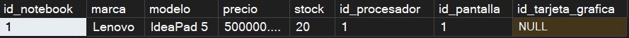
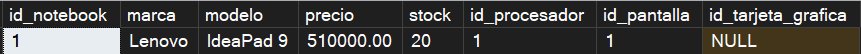
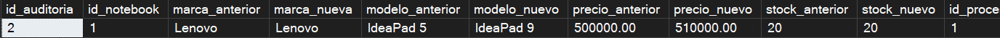
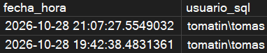
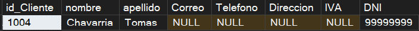
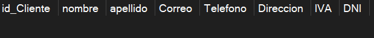
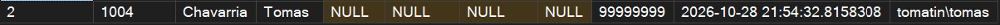
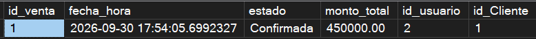
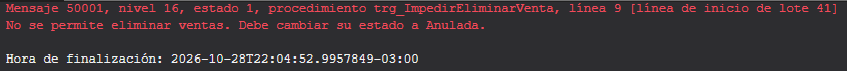
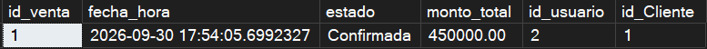

# Etapa V — Tema Técnico: Triggers de Auditoría

> **Tema:** Triggers de auditorías


## Introducción

Para esta etapa se investigaron e implementaron **triggers de auditoría** sobre el motor SQL Server, aplicados al sistema de ventas de LaptopDeel. Se resolvieron los dos requisitos pedidos por la cátedra mediante **3 triggers** distribuidos en 3 tablas distintas del modelo:

| # | Trigger | Tabla | Tipo | Qué resuelve |
|---|---|---|---|---|
| 1 | `trg_AuditoriaNotebook` | NOTEBOOK | `AFTER UPDATE` | Auditoría de modificaciones |
| 2 | `trg_AuditoriaEliminarCliente` | CLIENTE | `AFTER DELETE` | Auditoría de eliminaciones |
| 3 | `trg_ImpedirEliminarVenta` | VENTA | `INSTEAD OF DELETE` | Bloqueo de eliminación con mensaje de error |

Distribuir los triggers en tablas distintas, en lugar de concentrarlos en una sola, permitió demostrar los tres tipos de disparadores exigidos (`AFTER UPDATE`, `AFTER DELETE` e `INSTEAD OF DELETE`) sobre casos de negocio reales

---

## 1. Trigger de auditoría de modificaciones — NOTEBOOK

### 1.1 Definición y objetivo

Un trigger es un procedimiento que SQL Server ejecuta **automáticamente** cuando ocurre un evento (`INSERT`, `UPDATE` o `DELETE`) sobre una tabla. `trg_AuditoriaNotebook` es un trigger de tipo `AFTER UPDATE`: se ejecuta **después** de que una modificación sobre `NOTEBOOK` se completó con éxito.

El objetivo es que, cada vez que se modifique cualquier dato de una notebook (precio, stock, marca, modelo, procesador, pantalla o tarjeta gráfica), quede guardado automáticamente un historial con los valores anteriores y los nuevos, más la fecha, hora y usuario que hizo el cambio.

### 1.2 Ventajas y aplicaciones

- **Trazabilidad**: permite responder "¿quién cambió el precio de esta notebook, y cuándo? o ¿qué datos estaban antes?".
- **Automatismo**: se ejecuta solo, sin intervención del usuario.
- **Detección de errores operativos**: si un precio queda mal cargado, se puede reconstruir el historial para saber en qué momento se introdujo el error.

### 1.3 Implementación en SQL Server

Se creó una tabla auxiliar `AUDITORIA_NOTEBOOK` que guarda, por cada `UPDATE`, una fila con los valores **anteriores y nuevos** de todas las columnas de `NOTEBOOK`, más `fecha_hora` (con `SYSDATETIME()`) y `usuario_sql` (con `SUSER_SNAME()`).

El trigger usa las dos tablas temporales que crea SQL Server dentro de cualquier trigger:
- `deleted`: contiene la fila **tal como estaba antes** del `UPDATE`.
- `inserted`: contiene la fila **tal como quedó después** del `UPDATE`.

Ambas se relacionan por `id_notebook` (mediante `INNER JOIN`) porque un mismo `UPDATE` puede afectar a varias notebooks a la vez, y así cada fila de auditoría queda vinculada a la notebook correcta.

A propósito, `id_notebook` en `AUDITORIA_NOTEBOOK` **no es clave foránea**, ya que una tabla de auditoría debe poder conservar el historial aunque el registro original deje de existir en el futuro, sin que una restricción de integridad lo impida.


### 1.4 Caso concreto aplicado a LaptopDeel

Este trigger asegura que **todo cambio sobre una notebook quede registrado automáticamente**, lo que da soporte a una futura auditoría comercial (por ejemplo, revisar si un vendedor modificó precios sin autorización).
El precio mostrado al cliente y el stock disponible en mostrador dependen del catalogo de notebooks. Un cambio de precio o de stock mal controlado puede generar inconsistencias entre lo que se le cotiza al cliente y lo que realmente se factura. 

### 1.5 Script de demostración y resultados obtenidos

**Prueba realizada:** se modifica el precio (+$10.000) y el modelo de la notebook `id_notebook = 1`, y se verifica que el trigger generó automáticamente el registro correspondiente en `AUDITORIA_NOTEBOOK`.

```sql
-- Paso 1: Estado de la notebook 1 ANTES del cambio
SELECT *
FROM NOTEBOOK
WHERE id_notebook = 1;
```


```sql
-- Paso 2: Se modifica el precio y modelo. Esto dispara el trigger automáticamente
UPDATE NOTEBOOK
SET
    precio = precio + 10000,
    modelo = 'IdeaPad 9'
WHERE id_notebook = 1;
```

```sql
-- Paso 3: Se verifica que el cambio se aplicó en NOTEBOOK
SELECT *
FROM NOTEBOOK
WHERE id_notebook = 1;
```


```sql
-- Paso 4: Se verifica que el trigger registró el cambio en la auditoría, sin que nosotros hayamos hecho ningún INSERT manual
SELECT *
FROM AUDITORIA_NOTEBOOK
WHERE id_notebook = 1
ORDER BY id_auditoria DESC;
```



**Resultado obtenido:**
Al ejecutar el UPDATE, el precio de la notebook 1 pasó de $500.000 a $510.000 y el modelo cambió a 'IdeaPad 9'. 
Al consultar AUDITORIA_NOTEBOOK apareció una fila nueva con precio_anterior = $500.000, precio_nuevo = $510.000, modelo_anterior = 'IdeaPad 5', modelo_nuevo = 'IdeaPad 9', la fecha/hora real de la prueba y el usuario de SQL Server utilizado.

**Conclusión de la prueba:**
Se verificó que el trigger AFTER UPDATE registra automáticamente los cambios sin necesidad de ningún INSERT manual, incluso cuando se modifica más de una
columna en el mismo UPDATE, cumpliendo el objetivo de trazabilidad planteado.

---

## 2. Trigger de auditoría de eliminaciones — CLIENTE

### 2.1 Definición y objetivo

`trg_AuditoriaEliminarCliente` es un trigger de tipo `AFTER DELETE` que se ejecuta **después** de que un `DELETE` sobre `CLIENTE` se completó con éxito. A diferencia del trigger anterior, acá no hay "antes y después" que comparar — solo interesa **conservar** los datos del cliente justo antes de que desaparezcan de la tabla, junto con quién y cuándo lo borró.

### 2.2 Ventajas y aplicaciones

- **Preservación de datos históricos**: si un cliente se elimina, sus datos no se pierden del todo, quedan disponibles para consulta en la tabla de auditoría.
- **Responsabilidad**: queda registrado qué usuario de SQL Server ejecutó la eliminación, lo que es clave si en algún momento hay que investigar un borrado indebido.
- **Simplicidad de diseño**: no requiere `INNER JOIN` ni comparar `inserted` contra `deleted`, porque en un `DELETE` solo existe `deleted`.

### 2.3 Implementación en SQL Server

Se creó una tabla auxiliar `AUDITORIA_CLIENTE` que replica las columnas de `CLIENTE`, más `fecha_hora` y `usuario_sql`. El trigger `AFTER DELETE` toma los valores de la tabla temporal `deleted` (que contiene la fila tal como estaba justo antes de eliminarse) y los copia a `AUDITORIA_CLIENTE`, agregando `SYSDATETIME()` y `SUSER_SNAME()`.

Al igual que en el caso anterior, `id_Cliente` no es clave foránea en la tabla de auditoría, por la misma razón: el historial debe sobrevivir aunque el cliente original ya no exista en `CLIENTE`.


### 2.4 Caso concreto aplicado a LaptopDeel

**Observación importante detectada durante la implementación:** la tabla `CLIENTE` está relacionada con `VENTA` mediante la clave foránea `FK_Venta_Cliente`. Esto significa que, en la práctica, **no se puede eliminar un cliente que ya tiene ventas asociadas** — SQL Server rechaza el `DELETE` por integridad referencial *antes* de que este trigger llegue a dispararse. Por eso, la prueba de este trigger se hizo con un cliente creado específicamente para la ocasión, sin ventas relacionadas.

Esto demuestra que, en los casos donde sí es posible eliminar un cliente (por ejemplo, un cliente cargado por error, sin actividad comercial todavía), el sistema igual conserva un registro de auditoría de esa baja.

### 2.5 Script de demostración y resultados obtenidos

**Prueba realizada:** se crea un cliente de prueba (DNI `99999999`, sin ventas asociadas), se elimina, y se verifica que sus datos quedaron guardados en `AUDITORIA_CLIENTE` aunque ya no esté en `CLIENTE`.

```sql
-- Paso 1: Se crea un cliente exclusivo para la prueba
SELECT *
FROM CLIENTE
WHERE DNI = '99999999';

INSERT INTO CLIENTE (nombre, apellido, DNI)
VALUES ('Chavarria', 'Tomas', '99999999');
```

```sql
-- Paso 2: Estado ANTES de eliminar
SELECT *
FROM CLIENTE
WHERE DNI = '99999999';
```


```sql
-- Paso 3: Se elimina al cliente de prueba. Esto dispara el trigger
DELETE FROM CLIENTE
WHERE DNI = '99999999';
```

```sql
-- Paso 4: Verificamos que el cliente ya NO está en CLIENTE en la tabla
-- Resultado: sin registro
SELECT *
FROM CLIENTE
WHERE DNI = '99999999';
```


```sql
-- Paso 5: Verificamos que sus datos SÍ quedaron en la auditoría
-- Resultado: una fila con los datos del cliente eliminado, más fecha, hora y usuario
SELECT *
FROM AUDITORIA_CLIENTE
WHERE DNI = '99999999';
```



**Resultado obtenido:**
Tras eliminar el cliente de prueba (Tomas Chavarria, DNI 99999999), la consulta sobre CLIENTE no devolvió ninguna fila, confirmando que el registro se borrófísicamente. La consulta sobre 
AUDITORIA_CLIENTE sí devolvió una fila con todos los datos del cliente, la fecha/hora real de la eliminación y el usuario de SQL Server que ejecutó la operación.

**Conclusión de la prueba:**
Se verificó que el trigger AFTER DELETE conserva automáticamente los datos de un cliente eliminado, incluso cuando el registro original ya no existe en la tabla CLIENTE, cumpliendo el objetivo de preservar el historial.

---

## 3. Trigger de bloqueo de eliminación — VENTA

### 3.1 Definición y objetivo

`trg_ImpedirEliminarVenta` es un trigger de tipo `INSTEAD OF DELETE`. A diferencia de los dos anteriores (que son `AFTER`, es decir, se ejecutan *después* de que la operación ya ocurrió), un trigger `INSTEAD OF` se ejecuta **en lugar de** la operación original: cuando alguien intenta hacer un `DELETE` sobre `VENTA`, SQL Server no borra nada, en su lugar, corre el código de este trigger.

El objetivo es impedir por completo la eliminación física de cualquier venta, mostrando un mensaje de error explicativo al usuario que lo intente.

### 3.2 Ventajas y aplicaciones

- **Protección de datos críticos**: evita que una venta (que forma parte del historial comercial y contable de LaptopDeel) se borre por accidente o sin autorización.
- **Mensaje claro para quien opera la base**: en lugar de un error genérico de SQL Server, el usuario recibe una explicación de negocio ("cambie su estado a Anulada").

### 3.3 Implementación en SQL Server

El trigger revisa la tabla temporal `deleted` (que contiene las filas que se intentaron eliminar). Si existe al menos una fila, ejecuta `THROW 50001, '<mensaje>', 1`, lo que genera un error personalizado y corta la ejecución. Como el trigger **nunca ejecuta un `DELETE` real** contra la tabla, el registro permanece sin cambios en la base de datos.

El trigger impide eliminar cualquier venta, sin importar su `estado` (`Pendiente`, `Confirmada`, `Anulada`). Esta decisión se tomó porque, para el negocio, **ninguna venta debería desaparecer físicamente de la base**, incluso una venta `Pendiente` que se quiere descartar debe quedar reflejada como tal (o eventualmente anulada), no borrada, para no perder rastro de la operación comercial que se intentó realizar.


### 3.4 Caso concreto aplicado a LaptopDeel

Esta implementación está directamente conectada con la regla de negocio del equipo:

> **RN.20:** Una venta  no puede modificarse ni eliminarse. Solo puede ser anulada por un Administrador, quedando registrada como anulada, y las unidades vendidas vuelven al stock.

### 3.5 Script de demostración y resultados obtenidos

**Prueba realizada:** se intenta eliminar la venta `id_venta = 1` (estado `Confirmada`), y se verifica que la operación es rechazada con el mensaje de error, y que la fila sigue existiendo sin cambios.

```sql
-- Paso 1: Estado de la venta 1 ANTES del intento de eliminación
-- Resultado: la venta 1 existe, estado = 'Confirmada'
SELECT *
FROM VENTA
WHERE id_venta = 1;
```



```sql
-- Paso 2: Intento de eliminacion de la venta 1. Se va a disparar el trigger
-- Resultado: SQL Server NO ejecuta el borrado del registro y da el mensaje de error que definí en el trigger
DELETE FROM VENTA
WHERE id_venta = 1;
```



```sql
-- Paso 3: Estado DESPUÉS del intento de eliminación. Debe ser IDÉNTICO al Paso 1
-- Resultado : la fila sigue existiendo
SELECT *
FROM VENTA
WHERE id_venta = 1;
```



**Resultado obtenido:**
Al ejecutar el DELETE sobre la venta 1, SQL Server devolvió el error 'Msg 50001, Level 16, State 1: No se permite eliminar ventas. Para cancelar una venta, cambie su estado a Anulada.' y no se ejecutó ningún borrado: la consulta siguiente mostró la fila de la venta 1 exactamente igual que antes del intento.

**Conclusión de la prueba:**
Se verificó que el trigger INSTEAD OF DELETE bloquea de forma efectiva cualquier intento de eliminación sobre VENTA, preservando el historial comercial tal como exige la regla de negocio RN.20, y comunicando al usuario la vía correcta para dar de baja una venta (cambiar su estado a Anulada)

---

## Conclusiones generales

La implementación de estos 3 triggers demuestra que el motor de base de datos puede garantizar reglas de trazabilidad e integridad de negocio.
Los triggers AFTER UPDATE y AFTER DELETE permitieron construir un historial automático de cambios sobre NOTEBOOK y CLIENTE, mientras que el trigger INSTEAD OF DELETE sobre VENTA mostró cómo el motor puede impedir por completo una operación, aplicando una regla de negocio (RN.20) directamente a nivel de base de datos